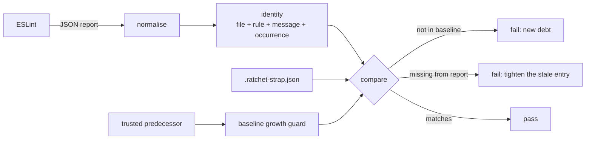

<p align="center">
  
</p>

<h1 align="center">RatchetStrap</h1>

<p align="center">
  <em>A ratchet for lint debt. New violations fail, repaired ones must be removed,<br>and the baseline only ever shrinks.</em>
</p>

<p align="center">
  <a href="https://github.com/chester-hill-solutions/ratchet-strap/actions/workflows/ci.yml"></a>
  
  <a href="LICENSE"></a>
  
</p>

---

ESLint finds violations. RatchetStrap compares them with a baseline you review
and commit. An identity that is not in the baseline fails the gate; an identity
that no longer appears must be tightened out. The baseline is compared with a
trusted revision, so it cannot be raised to make a change pass.

The engine is deliberately opinion-free: thresholds, named profiles and enabled
golden rules live in a `house-rules/` directory your repository owns.

```console
$ ratchet-strap check --exec-eslint
{
  "ok": false,
  "mode": "identities",
  "added": {
    "max-params": [
      "src/mail.js:max-params:Function 'sendMessage' has too many parameters (6). Maximum allowed is 5.#1"
    ]
  },
  "stale": {}
}
$ echo $?
1
```

## Why

Coding agents are good at making a red check green. Left alone they mock the
thing under test, sleep until a race usually goes their way, retry the flake,
raise the timeout, or add an `// eslint-disable`. Every one of those passes CI.

RatchetStrap makes the honest path the one that also passes:

- a new identity fails;
- a suppressed diagnostic still counts;
- a repaired identity must be removed, not left as an allowance;
- the baseline can only lose entries.

## Install

```bash
npm install --save-dev ratchet-strap
# or
bun add --dev ratchet-strap
```

Requires Node 20.11 or later. RatchetStrap uses your project's ESLint; it never
installs, upgrades or reconfigures one.

## Quick start

Enable the rules you want to ratchet in your ESLint flat config, then record
the existing debt once:

```bash
ratchet-strap init --rules no-console,complexity --exec-eslint
ratchet-strap check --exec-eslint
```

After repairing debt:

```bash
ratchet-strap tighten --exec-eslint         # preview the removal
ratchet-strap tighten --exec-eslint --write # apply it
```

After enabling another rule:

```bash
ratchet-strap add --rules no-alert --exec-eslint --write
```

Already have a report? Skip the runner:

```bash
eslint . --format json --no-cache --output-file eslint-report.json
ratchet-strap check --report eslint-report.json
```

## How it works



Identity keys exclude line and column, so moving unchanged code within a file
does not invalidate the baseline. Suppressed messages participate in the same
occurrence numbering, so a suppression cannot hide a tracked diagnostic.

## House rules

Copy the starter and edit it:

```bash
cp -R node_modules/ratchet-strap/house-rules ./house-rules
```

```js
// eslint.config.mjs
import { houseRules } from "./house-rules/index.mjs";

export default [
  { files: ["**/*.{ts,tsx}"], rules: { ...houseRules.policy.rules } },
];
```

The CLI loads `./house-rules/index.mjs` by default; use `--house-rules FILE`
to point elsewhere. Programmatic consumers call `configureHouseRules()`.

| File | Contents |
| --- | --- |
| `quality.mjs` | A named ESLint rule record and its versioned id. |
| `golden.mjs` | Opt-in golden profiles and the set you enable. |
| `index.mjs` | The module the CLI and API load. |

Keep it in version control: a package upgrade cannot change your thresholds,
your enabled profiles or your exclusions.

## Profiles

| Profile | Adapter | Comparison |
| --- | --- | --- |
| `eslint@1` **default** | `eslint-identities@1` | New and stale identities fail |
| `eslint-counts@1` | `eslint-json@1` | Per-rule warning and suppressed counts cannot grow |
| `legacy-counts@1` | `suppression-counts@1` | Suppression-comment accounting for an existing count gate |
| `legacy-identities@1` | `identities-cycles@1` | Identities plus import cycles and predecessor protection |
| `legacy-messages@1` | `message-counts@1` | Message counts for an existing message-based gate |
| `legacy-strict-counts@1` | `strict-counts@1` | Strict suppression budgets with a required Git base |

New projects should use `eslint@1`. The legacy profiles exist to preserve a
gate that already exists, not as a starting point. Baselines pin their adapter,
and there is no implicit conversion between counts and identities.

## Commands

| Command | Does |
| --- | --- |
| `init` | Create a baseline from explicit rules and current debt |
| `check` | Fail on new debt or a stale entry; never writes |
| `tighten` | Remove repaired entries; preview unless `--write` |
| `add` | Track another rule and accept only its initial debt |
| `inspect` | Print the baseline, profile and tracked rules |
| `rules` / `profiles` | Print the configured policy and profiles |
| `detect` / `migrate` / `verify` | Recognise and migrate a legacy gate |
| `import-*` | Import a recognised legacy baseline |

Output is JSON. Exit codes: `0` passed, `1` violations or new debt,
`2` invalid input or tool failure. `--previous-baseline FILE` rejects growth
against a versioned predecessor; fetch full history in CI (`fetch-depth: 0`).

## Golden defaults

<details>
<summary>Twelve rules every consumer follows, independent of language or framework.</summary>

| Id | Rule |
| --- | --- |
| U1 | A change that adds a tracked violation fails the gate. |
| U2 | A baseline may only lose entries. Never raise one to make a change pass. |
| U3 | A suppressed or disabled diagnostic still counts as a violation. |
| U4 | A repaired violation must be removed from the baseline. |
| U5 | Every exemption is scoped to one rule, one location and one written reason. |
| U6 | One local command runs exactly the same checks as CI. |
| U7 | Generated artefacts reproduce with no diff. |
| U8 | Every gate has a fault and a control fixture proving both directions. |
| U9 | No secret value reaches a response, log, span, error or built artefact. |
| U10 | A published change carries a version bump and a changelog line. |
| U11 | A shared module mock keeps the real export surface. |
| U12 | Guarded code cannot opt out of the gate that guards it. |

</details>

`GOLDEN_RULES`, `assertGoldenRules()`, `assertGoldenProfiles()` and
`goldenProfile()` are exported. Profiles come from your house rules; the engine
ships none.

## API

```ts
import {
  configureHouseRules,
  parseRatchetBaseline,
  checkBaseline,
  tightenBaseline,
  addRules,
  parseIdentityBaseline,
  evaluateIdentities,
  tightenIdentities,
} from "ratchet-strap";
```

The CLI is the supported surface for most users; the API mirrors it.

## Limits

- The engine never downloads ESLint and never changes your configuration.
- Historical comparison requires the predecessor file or the Git history.
- Identities are diagnostic, not semantic: a rename or a message change can
  require a reviewed migration.
- Count profiles are weaker by design; one repaired violation can offset one new
  violation of the same rule. Prefer identities.

## Contributing

Issues and pull requests are welcome. See [CONTRIBUTING.md](CONTRIBUTING.md) and
[SECURITY.md](SECURITY.md). Run the same checks as CI:

```bash
bun install
bun run typecheck && bun run build && bun run test
```

## License

MIT. See [LICENSE](LICENSE).
