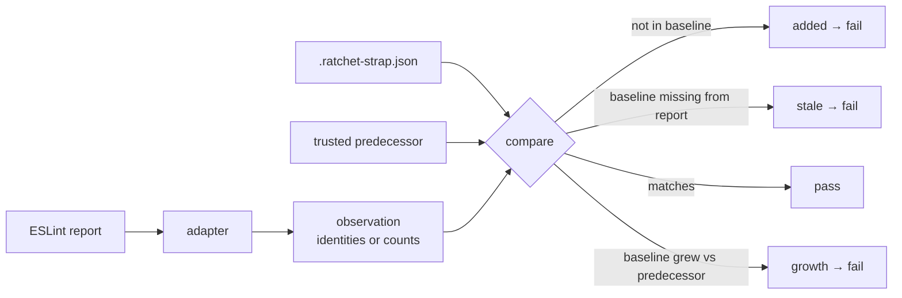

<p align="center">
  
</p>

<h1 align="center">RatchetStrap</h1>

<p align="center">
  <em>A ratchet for lint debt. New violations fail, repaired ones must be removed,<br>and the baseline only ever shrinks.</em>
</p>

<p align="center">
  <a href="https://github.com/chester-hill-solutions/ratchet-strap/actions/workflows/ci.yml"></a>
  
  <a href="LICENSE"></a>
  
</p>

---

ESLint finds violations. RatchetStrap compares them with a baseline you review
and commit. An identity that is not in the baseline fails the gate; an identity
that no longer appears must be tightened out. The baseline is compared with a
trusted revision, so it cannot be raised to make a change pass.

The engine is deliberately opinion-free: thresholds, named profiles and enabled
golden rules live in a `house-rules/` directory your repository owns.

```console
$ ratchet-strap check --exec-eslint
{
  "ok": false,
  "mode": "identities",
  "added": {
    "max-params": [
      "src/mail.js:max-params:Function 'sendMessage' has too many parameters (6). Maximum allowed is 5.#1"
    ]
  },
  "stale": {}
}
$ echo $?
1
```

## The model

**ESLint finds violations. The baseline records the ones you have agreed to live
with. Every run proves the difference did not grow.**

That is the whole product. Three outcomes:

| What the report shows | What it means | Gate |
| --- | --- | --- |
| A violation that is **not** in the baseline | New debt | **fail** |
| A baseline entry that **did not** appear | You repaired it, but the allowance is still there | **fail** until tightened |
| A baseline that grew relative to a trusted revision | Someone raised the allowance | **fail**, whatever the report says |

There is no "pass with new warnings". A green run means the baseline and the
report still describe the same debt, and that the baseline has not grown since
the last reviewed revision.

## Why

Coding agents are good at making a red check green. Left alone they mock the
thing under test, sleep until a race usually goes their way, retry the flake,
raise the timeout, or add an `// eslint-disable`. Every one of those passes CI.

RatchetStrap is built so the shortcut is *also* a gate failure:

| Shortcut | What RatchetStrap does |
| --- | --- |
| Fix the code but leave the allowance | `stale` entry fails until `tighten` |
| Add a violation somewhere else | `added` identity fails |
| Disable the rule inline | Suppressed diagnostics still count |
| Add the new identity to the baseline | Predecessor comparison fails |
| Raise a count budget | Counts are non-increasing |
| Rerun until it passes | The comparison is deterministic |

## How it works



1. **Detect.** RatchetStrap runs your installed ESLint (`--exec-eslint`) or
   reads a report you already produced (`--report FILE`). It never installs,
   upgrades or reconfigures ESLint.
2. **Normalise.** An adapter turns diagnostics into a comparable observation.
   The default is an **identity**: file, rule, message and occurrence number.
   Line and column are excluded, so moving unchanged code within a file does not
   invalidate the baseline. Suppressed messages are included in the numbering.
3. **Compare.** The observation is diffed against the baseline, and the baseline
   is diffed against a predecessor (a file, the previous commit, or the CI base
   ref, depending on the profile). Any new debt, stale allowance, unsuppressed
   error or baseline growth fails the gate.
4. **Record.** `init` establishes the baseline once, `tighten` removes repaired
   entries, and `add` accepts only the initial debt of a new rule. Each refuses
   to absorb an unrelated regression.

## A worked example

Suppose the baseline carries one known violation:

```json
{
  "schemaVersion": 2,
  "mode": "identities",
  "adapter": "eslint-identities@1",
  "identities": {
    "max-params": [
      "app/mail.js:max-params:Function 'sendMessage' has too many parameters (6). Maximum allowed is 5.#1"
    ]
  }
}
```

Someone adds a second six-parameter function and refactors the first one. The
report now has one new diagnostic and none of the old one:

```console
$ ratchet-strap check --report eslint-report.json
{
  "ok": false,
  "added": {
    "max-params": [
      "app/notify.js:max-params:Function 'notify' has too many parameters (6). Maximum allowed is 5.#1"
    ]
  },
  "stale": {
    "max-params": [
      "app/mail.js:max-params:Function 'sendMessage' has too many parameters (6). Maximum allowed is 5.#1"
    ]
  }
}
$ echo $?
1
```

Two separate facts, both true: new debt arrived, and the recorded debt was
repaired. The gate is red until both are dealt with:

```bash
# remove the new debt, then record the repair
ratchet-strap tighten --exec-eslint --write
```

`tighten` recomputes the baseline from the current report. It refuses if the
report contains a new identity, an ESLint error or baseline growth, so it cannot
be used to launder a regression.

## Two counting modes

| Mode | Identity | Detects | Cannot distinguish |
| --- | --- | --- | --- |
| `identities` **default** | file + rule + message + occurrence | A new occurrence anywhere; a repair must be tightened out | Removal and replacement of the same occurrence in one file |
| `counts` | per-rule total | Growth beyond the recorded budget | One repair offsetting one new violation of the same rule |

New projects should use identities. Count profiles exist to preserve a gate that
already exists, and every legacied profile pins its adapter in the baseline.
There is no implicit conversion between the two.

## Install

```bash
npm install --save-dev ratchet-strap
# or
bun add --dev ratchet-strap
```

Requires Node 20.11 or later.

## Quick start

Enable the rules you want to ratchet in your ESLint flat config, then record the
existing debt once:

```bash
ratchet-strap init --rules no-console,complexity --exec-eslint
ratchet-strap check --exec-eslint
```

After repairing debt:

```bash
ratchet-strap tighten --exec-eslint         # preview the removal
ratchet-strap tighten --exec-eslint --write # apply it
```

After enabling another rule:

```bash
ratchet-strap add --rules no-alert --exec-eslint --write
```

Already have a report? Skip the runner:

```bash
eslint . --format json --no-cache --output-file eslint-report.json
ratchet-strap check --report eslint-report.json
```

## House rules

Copy the starter and edit it:

```bash
cp -R node_modules/ratchet-strap/house-rules ./house-rules
```

```js
// eslint.config.mjs
import { houseRules } from "./house-rules/index.mjs";

export default [
  { files: ["**/*.{ts,tsx}"], rules: { ...houseRules.policy.rules } },
];
```

The CLI loads `./house-rules/index.mjs` by default; use `--house-rules FILE`
to point elsewhere. Programmatic consumers call `configureHouseRules()`.

| File | Contents |
| --- | --- |
| `quality.mjs` | A named ESLint rule record and its versioned id. |
| `golden.mjs` | Opt-in golden profiles and the set you enable. |
| `index.mjs` | The module the CLI and API load. |

Keep it in version control: a package upgrade cannot change your thresholds,
your enabled profiles or your exclusions.

## Profiles

| Profile | Adapter | Comparison |
| --- | --- | --- |
| `eslint@1` **default** | `eslint-identities@1` | New and stale identities fail |
| `eslint-counts@1` | `eslint-json@1` | Per-rule warning and suppressed counts cannot grow |

New projects should use `eslint@1`. A project that already has a count gate can
adopt `eslint-counts@1` deliberately; baselines pin their adapter, and there is
no implicit conversion between counts and identities.

## Commands

| Command | Does |
| --- | --- |
| `init` | Create a baseline from explicit rules and current debt |
| `check` | Fail on new debt or a stale entry; never writes |
| `tighten` | Remove repaired entries; preview unless `--write` |
| `add` | Track another rule and accept only its initial debt |
| `inspect` | Print the baseline, profile and tracked rules |
| `rules` / `profiles` | Print the configured policy and profiles |

Output is JSON. Exit codes: `0` passed, `1` violations or new debt,
`2` invalid input or tool failure. `--previous-baseline FILE` rejects growth
against a versioned predecessor; fetch full history in CI (`fetch-depth: 0`).

## Golden defaults

<details>
<summary>Twelve rules every consumer follows, with the mechanism that proves each one.</summary>

| Id | Rule | Enforced by |
| --- | --- | --- |
| U1 | A change that adds a tracked violation fails the gate. | Engine: `check` compares report and baseline |
| U2 | A baseline may only lose entries. Never raise one to make a change pass. | Engine: predecessor growth guard |
| U3 | A suppressed or disabled diagnostic still counts as a violation. | Engine: suppressed diagnostics are counted; unsuppressed errors fail |
| U4 | A repaired violation must be removed from the baseline. | Engine: a stale entry fails until `tighten` |
| U5 | Every exemption is scoped to one rule, one location and one written reason. | Review: the exemption is scoped and recorded |
| U6 | One local command runs exactly the same checks as CI. | Consumer: one command, local and CI |
| U7 | Generated artefacts reproduce with no diff. | Consumer: a build-and-diff check |
| U8 | Every gate has a fault and a control fixture proving both directions. | Consumer: a fault and a control fixture per gate |
| U9 | No secret value reaches a response, log, span, error or built artefact. | Consumer: a secret scan over code and artefacts |
| U10 | A published change carries a version bump and a changelog line. | Consumer: a version and changelog gate |
| U11 | A shared module mock keeps the real export surface. | Consumer: a mock detector |
| U12 | Guarded code cannot opt out of the gate that guards it. | Review: the gate configuration is protected |

</details>

The table is honest about the boundary: four rules are proved by this engine,
the rest by the consumer's checks or review. `GOLDEN_RULES` carries the same
`enforcement` metadata, and `assertGoldenRules()` refuses a rule with none.

## API

```ts
import {
  configureHouseRules,
  parseRatchetBaseline,
  checkBaseline,
  tightenBaseline,
  addRules,
  parseIdentityBaseline,
  evaluateIdentities,
  tightenIdentities,
} from "ratchet-strap";
```

The CLI is the supported surface for most users; the API mirrors it.

## Limits

- The engine never downloads ESLint and never changes your configuration.
- Historical comparison requires the predecessor file or the Git history.
- Identities are diagnostic, not semantic: a rename or a message change can
  require a reviewed migration.
- Count profiles are weaker by design; one repaired violation can offset one new
  violation of the same rule. Prefer identities.

## How it is tested

The gate is tested the way it tests a project: with a fault and a control.

- **92 tests in 8 files** (`bun test src/`), run with typecheck and build in CI
  on every push and pull request.
- Identity and count comparisons have a fixture that must fail and a control
  that must pass. The golden set makes that a requirement: U8 says every gate
  needs both directions.
- CLI tests spawn the real CLI in throwaway directories with real report files
  and a fake ESLint executable. They assert the exit code (0/1/2), the JSON
  output, and that a failed run left the baseline byte-identical.
- Baseline writers are tested against the lock, an interrupted write, unchanged
  input and a refused overwrite.
- The golden defaults and the house-rules loader have their own tests.

A consumer should keep the same pair around its gate: a planted violation that
must exit 1, a clean report that must exit 0, and a raised baseline that must
exit 1 through the growth guard.

## Contributing

Issues and pull requests are welcome. See [CONTRIBUTING.md](CONTRIBUTING.md) and
[SECURITY.md](SECURITY.md). Run the same checks as CI:

```bash
bun install
bun run typecheck && bun run build && bun run test
```

## License

MIT. See [LICENSE](LICENSE).
